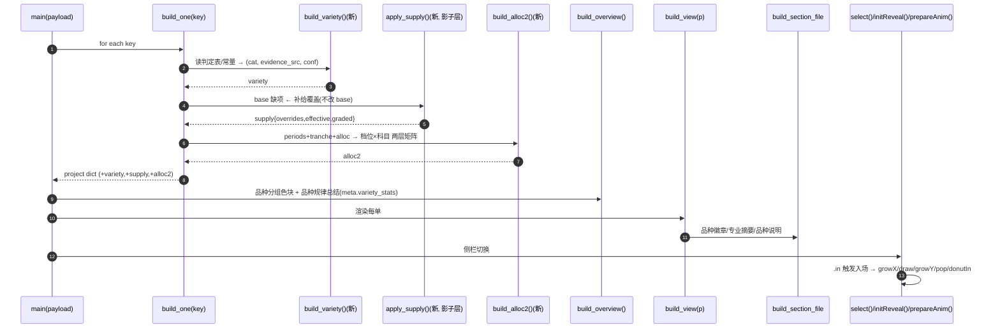

# 增量设计 v2 · 清算 28 单 · 单项目穿透分析报告

> 角色：架构师（高见远）｜性质：**第二轮增量设计**（在已交付 v1 报告上做三块改造）
> 落盘：`E:\不良ABS穿透研究\清算28单_单项目穿透\_校验件\增量设计_v2.md`
> 效力次序：`增量口径裁定_v1..v5` > 本设计 > `增量设计_v1.md` > `增量PRD_v1.md` > `设计_清算28单报告.md`。
> 数据纪律：**数据只读 / 断言独立 / 口径人定 / 缺失≠通过 / 不臆补缺失 / 不删既有披露**。
> 本次**只写本 md**，不改任何代码或产物；R2 的 OCR 回源由工程师另一路执行，本文只约定**接口与降级次序**。

---

## 0. 已采信事实（沿用既有裁定，不重探）

| 事实 | 值 / 结论 | 来源 |
|---|---|---|
| 分档表 | `tranche.period_principal[t][k]`/`period_interest[t][k]`，t∈{0 优先,1 次级}，`None`=该档当期无该现金流 | 裁定 v1 §3.1 / v2 ★A |
| **次级档利息语义** | `period_interest[1]` **已含**「固定资金成本＋超额收益」受偿额 → **严禁**再叠加 outflow 次级档科目 | 裁定 v1 §1③ |
| **P0 命名缺陷** | `优先档资产支持证券本金` 的 raw 实为「证券本金总支出」＝**两档合计**；`…利息` raw＝「证券利息总支出」＝**两档合计**。**不得**当优先档行用 | 裁定 v1 §2.1 |
| 分档 vs 分配两表 | 逐期一致性规则 R‑1..R‑4；`中誉至诚2023年第四期` 第4期 R‑2 补录 12,689,556.91 元 | 裁定 v5 §三 |
| 缺口披露 5 类 | 两表本金口径差=2 / 分档数据缺失=1 / 支付期日期缺失=1 / 分配表缺=4单(5期) / 分档表缺·补录=1 | 裁定 v5 §五 |
| 既有断言基线 | A1–A12、B1–B9、C1–C5、D1–D5、R1–R5 全部 exit 0；`data-computable="false"` 恰 1 | `_chk_liq28.py` |
| **既有 payload 顶层新键** | `alloc` / `alloc_label_display` / `xirr`（28×3）；R1 断言 `new_key_count==28*3` | `_chk_liq28.py:753,846` |
| 28 单资产类型 | **权威判定表已存在**（逐单取自发行说明书「基础资产为…」定义句） | `abs_ocr_workspace\清算项目_资产类型判定表.csv` |

---

# 第 1 部分 · R1 审美对标（品种介绍 / 色块 / 图表动态化）

## 1.1 品种归类表（**28 单逐单 · 有据**）

**归据（三级证据，均来自 `发行说明书` 定义句，非系列名推断）**：
判定依据 = `abs_ocr_workspace\清算项目_资产类型判定表.csv` 的「判定依据(原文)」列（该表由 `stage2_classify.py`/`stage2_exclude.py` 生成，规则见 `abs_ocr\extractors.py:ASSET_PATTERNS`）。**交叉验证信号**：pool 字段 `mortgage_eval/mortgage_rate/mortgage_loan_pct/mortgage_rec_pct` 与 dist 维度 `mortgage` 存在 ⇒ 含抵押物。

| # | 项目 key | 银行 | **品种 cat** | 判据（定义句原文节选） | 置信度 | 备注 |
|---|---|---|---|---|---|---|
| 1 | 中誉至诚2023年第四期 | 中国银行 | **个人消费贷款** | 基础资产为无抵押担保的不良个人消费类贷款 | 高 | |
| 2 | 中誉至诚2024年第五期 | 中国银行 | **信用卡不良** | 基础资产为不良信用卡债权 | 高 | |
| 3 | 交诚2023年第一期 | 交通银行 | **信用卡不良** | 不良信用卡债权 | 高 | |
| 4 | 交诚2023年第四期 | 交通银行 | **信用卡不良** | 不良信用卡债权 | 高 | |
| 5 | 建鑫2022年第一期 | 建设银行 | **信用卡不良** | 基础资产为不良信用卡债权 | 高 | |
| 6 | 建鑫2022年第六期 | 建设银行 | **信用卡不良** | 基础资产为不良信用卡债权 | 高 | |
| 7 | 招元和萃2023年第八期 | 招商银行 | **信用卡不良** | 基础资产为个人信用卡不良贷款 | 高 | |
| 8 | 招元和萃2024年第一期 | 招商银行 | **信用卡不良** | 基础资产为个人信用卡不良贷款 | 高 | |
| 9 | 招元和萃2024年第二期 | 招商银行 | **信用卡不良** | 基础资产为个人信用卡不良贷款 | 高 | |
| 10 | 橙益2024年第一期 | 平安银行 | **个人消费贷款** | 基础资产为个人消费不良贷款 | 高 | |
| 11 | 橙益2024年第九期 | 平安银行 | **个人经营贷款** | 基础资产为不良个人经营贷款 | 高 | **含抵押**：pool 有 `mortgage_*`、dist 有 `mortgage` 维度 → 标注「经营·抵押」 |
| 12 | 橙益2024年第八期 | 平安银行 | **信用卡不良** | 基础资产为个人信用卡不良贷款 | 高 | |
| 13 | 橙益2024年第十一期 | 平安银行 | **信用卡不良** | 基础资产为个人信用卡不良贷款 | 高 | |
| 14 | 橙益2024年第十二期 | 平安银行 | **信用卡不良** | 基础资产为个人信用卡不良贷款 | 高 | |
| 15 | 橙益2025年第十二期 | 平安银行 | **信用卡不良** | 基础资产为个人信用卡不良贷款 | 高 | |
| 16 | 福鑫2024年第一期 | 光大银行 | **信用卡不良** | 本期资产支持证券的基础资产是…信用卡不良债权 | 高 | |
| 17 | 福鑫2024年第六期 | 光大银行 | **信用卡不良** | 同上 | 高 | |
| 18 | 臻粹2023年第六期 | 广发银行 | **信用卡不良** | 基础资产为个人信用卡不良贷款 | 高 | |
| 19 | 臻粹2024年第一期 | 广发银行 | **信用卡不良** | 基础资产为个人信用卡不良贷款 | 高 | |
| 20 | 臻粹2024年第三期 | 广发银行 | **信用卡不良** | 基础资产为个人信用卡不良贷款 | 高 | |
| 21 | 臻粹2024年第二期 | 广发银行 | **信用卡不良** | 基础资产为个人信用卡不良贷款 | 高 | |
| 22 | 邮盈惠兴2024年第五期 | 邮储银行 | **个人经营贷款** | 基础资产为个人经营不良贷款 | 高 | |
| 23 | 邮盈惠兴2024年第八期 | 邮储银行 | **信用卡不良** | 基础资产为个人信用卡不良贷款 | 高 | |
| 24 | 邮盈惠兴2024年第六期 | 邮储银行 | **个人消费贷款** | 基础资产为不良个人消费类贷款 | 高 | |
| 25 | 邮盈惠兴2024年第四期 | 邮储银行 | **信用卡不良** | 基础资产为个人信用卡不良贷款 | 高 | dist 全缺（forecast 空），品种仍可判（据判定表） |
| 26 | 邮盈惠泽2025年第三期 | 邮储银行 | **信用卡不良** | 基础资产为个人信用卡不良贷款 | 高 | |
| 27 | 鸿富2023年第七期 | 民生银行 | **信用卡不良** | 本期证券的基础资产为信用卡不良贷款 | 高 | |
| 28 | 鸿富2023年第三期 | 民生银行 | **信用卡不良** | 基础资产为信用卡不良贷款 | 高 | |

**分布**：信用卡不良 **23** / 个人消费贷款 **3**（#1、#10、#24）/ 个人经营贷款 **2**（#11、#22）。**「未归类」= 0**（全部有发行说明书定义句证据）。
**披露要求**：① 品种来源 = 外部源文件 `清算项目_资产类型判定表.csv`，payload 记 `variety.evidence_src`；② 若某单在判定表中缺失（本批为 0）→ `cat="未归类"` 并**进披露区**（类型 `未归类品种`），**不得**据项目名臆断。

### 品种说明文案模板（渲染层常量 `VARIETY_PROFILE`）

- **信用卡不良**（信用卡透支本息费债权）
  - 资产特征：无抵押、无担保；单笔金额小、户数极多（万级）、单户占比低、高度分散。
  - 回收规律：回收率低（个位数～低两位），**现金流前置、衰减快**；回收质量高度依赖催收与委外效率。
  - 典型处置：批量委外催收为主、诉讼为辅；**处置费率相对较高**；无抵押物处置环节。
- **个人消费贷款**（无/弱担保的个人消费不良贷款）
  - 资产特征：无抵押或弱担保；单笔较小、户数较多；期限较短。
  - 回收规律：回收率中低、**节奏较平缓**（前期不如信用卡激进）。
  - 典型处置：委外催收＋诉讼/协商并重；处置费率中等。
- **个人经营贷款**（个体工商户/小微业主经营性不良贷款）
  - 资产特征：单笔金额较大、**常附抵押/担保**（本批 2 单中 #11 含抵押物评估字段）。
  - 回收规律：回收率相对较高、**周期较长**（抵押物处置慢）、单户集中度较高。
  - 典型处置：抵押物处置（司法拍卖/协商变卖）为主，诉讼周期长；处置费率中等偏低。

## 1.2 落点与调用链（R1）

| 改造点 | 落点函数（改/新） | 说明 |
|---|---|---|
| 品种徽章 + 专业摘要 + 品种说明 | `pen_report_liq28.py`：**新增** `build_variety_head(p)`；在 `build_section_file()` 顶部**插入** | `.cat` chip（品种色）+ `.chips`（银行/评级/存续期/品种判据）+ `.hsum` 专业摘要 + 品种说明折叠 |
| 品种 chip（总览卡） | `build_overview()` 内**追加** `<span class="vchip">` | 卡片保留银行色顶条（`--bc`），另加品种色 chip |
| 品种分组色块 + 品种统计 | `build_overview()` **新增** `secVarietyBands()`（按品种分组的色带 + 每类计数/入池合计/平均回收率/平均处置费率/平均XIRR） | 数据取 `meta.variety_stats` |
| 品种规律总结（一屏） | `build_overview()` **新增** `secVarietySummary()`（`grid3` 三列，v18 §7 风格：品种名+一句话特征+本批派生统计+启示行） | 文案模板 `VARIETY_PROFILE` |
| 品种色令牌 / 色块体系 | `CSS` 常量**追加** `--v-*` 令牌 + 每 view `--accent` | 见 §1.3 |
| 图表动态化 | `CSS` 追加关键帧；`JS` 追加 `initReveal()/prepareAnim()`；`select()` 内调用；各 `svg_*` 给图元加动画 class | 见 §第4部分 |
| 数据侧 | `build_liq28_payload.py` **新增** `VARIETY_MAP` + `build_variety()`；`meta.variety_stats` | 纯追加新键 |

**调用链（一段话）**：
`build_liq28_payload.main()` → `build_one(key,liq)` 内**追加** `build_variety(key)`（读判定表/常量 → `variety`）与 `meta.variety_stats` 聚合；渲染侧 `pen_report_liq28.main()` → `build_overview(data,slug)`（品种分组区 + 品种规律总结）与逐单 `build_view(p)` → `build_section_file(p)`（品种徽章/说明）→ … → 各 `svg_*`（图元带动画 class）。JS：`select(view)` 内先 `initReveal(view)`（加 `.in`）再 `prepareAnim(view)`（量测 `getTotalLength` 设 `--len`）。



## 1.3 设计令牌与色块体系（R1-B）

> 母版 v18 的 `--accent / --accent-soft / --accent-line`（按项目**动态着色**）+ `--grad` + 状态色，是本报告完全缺失的能力。本报告此前为**固定**令牌，无法按品种/项目切换主色。

**新增令牌（`CSS :root` 追加，不改既有 `--ink/--red/--green/--amber/--canvas/--card/--muted/--line/--soft`）**

| 令牌 | 取值 | 用途 |
|---|---|---|
| `--accent` | 运行时按 **品种** 注入 | 品种徽章、`sec-num`、`hsum` 左边线、`.tl`、表头、图表主色 |
| `--accent-soft` | 品种浅底 | `.cat`/`chip`/表头底/KPI `hi` |
| `--accent-line` | 品种描边 | chip 边线、`.fold-h em`、卡片 hover 边 |
| `--grad` | `linear-gradient(135deg,#A52524 0%,#C2543F 46%,#2D3955 100%)` | `.hero::before` 顶条、`sec-num` |
| `--v-credit` / `--v-consumer` / `--v-business` | 见下表（含 `-soft`/`-line`） | 品种分组色带 / 图例 / chip |

**品种配色 `VARIETY_COLORS`（新增；与 `BANK_COLORS` 并存、职责分离）**

| 品种 | accent | soft | line |
|---|---|---|---|
| 信用卡不良 | `#A52524` | `#FBEFEF` | `#E9C7C6` |
| 个人消费贷款 | `#2D3955` | `#EEF0F3` | `#D5D9E2` |
| 个人经营贷款 | `#1F7A5C` | `#E9F4F0` | `#CBE6DA` |
| （未归类） | `#8aa0b6` | `#EEF1F5` | `#D8DFE8` |

**与既有 `BANK_COLORS` 的关系（单点分工，禁止混用打架）**
- **银行色（`BANK_COLORS` 9 家，复用不动）**：侧栏银行分组头、总览卡**顶条** `--bc`（导航维度）。
- **品种色（`VARIETY_COLORS` 新增）**：每单 `<section class="view">` 的 `--accent` 三元组（面板主题色）、总览品种分组色带、品种 chip。**面板内所有 `.sec-num/.cat/.hsum/.tl/表头/图表` 一律引用 `var(--accent)`**，不得再硬编码颜色。
- **科目色（复用 v18 `GROUPS`）**：R3 两层矩阵与分档图例用色泽体系（优先档本金/利息、次级档本金/固定成本/超额收益、费用类、转存下期、其他）——同一套色贯通「分档矩阵 / 瀑布 / 分配矩阵」。
- **状态色**：沿用既有 `.pill.ok/.warn/.bad`（`--green/--amber/--red`）与 v18 `t-final/t-clear/t-open`（清算终局/收尾中/次级未终局）——**statusOf 语义单点**。

**色块展示清单**：① 总览「品种分组色带」（`border-left:6px solid var(--v-*)` + 色块 chip + 计数）；② 总览卡「品种 chip」；③ 面板顶部「品种徽章」；④ 各节标题序号块（`--grad`）；⑤ 图表图例（`legend`/`lg`）；⑥ 矩阵档位行首色条（`data-tier` 着色）。

---

# 第 2 部分 · R3 分配明细矩阵按「档位 × 科目类型」重构

## 2.1 数据来源必须分清（关键）

| 块 | 行 | **权威来源** | 备注 |
|---|---|---|---|
| 【证券受偿】 | 优先档·本金 / 优先档·利息 / 次级档·本金 / 次级档·收益合计 | **分档兑付表** `tranche.period_principal[档][期]`、`period_interest[档][期]` | 天然分档、权威；`None`→`—`。**次级档·收益合计 = `period_interest[1]`（已含固定成本＋超额收益）** |
| 【证券受偿·次级拆分】 | 其中：固定资金成本 / 其中：超额收益 | **分配表** `outflow[「次级档资产支持证券固定资金成本」「次级档资产支持证券超额收益」]` | 仅分配表存在期有值；缺期显示 `—`（**不补 0**），并注「拆分口径＝分配表」 |
| 【费用与其他】 | 处置费用 / 贷款服务机构报酬 / 税费支出 / 受托机构报酬 / 资金保管机构报酬 / 代理兑付费用 / 跟踪评级服务费 / 审计费 / 发行费用 / 其他费用支出 / 流动性支持承诺费 / 转存下期金额 | **分配表** `outflow[]` | 取本单实际出现的费用类 label |
| 【参考行】 | 本期回收流入（资产池） / 各项流出合计 / 支出／回收（当期） | `account.in` / `Σoutflow` | 参考，不计入受偿 |

**P0 命名缺陷硬约束**：`优先档资产支持证券本金/利息`（raw＝证券本金/利息**总支出**＝两档合计）**绝不**直接当优先档行；优先/次级本金一律取分档表 `pp[0]/pp[1]`，利息取 `pi[0]`，次级收益取 `pi[1]`。两表逐期冲突按 **裁定 v5 R‑1..R‑4** 处理。

## 2.2 两层矩阵 DOM 结构

```html
<div class="card" data-chart="alloc-matrix"            <!-- 保留既有卡名：B2/R5 计数不变 -->
     data-rec-total="{alloc.rec_total}" data-out-total="{alloc.out_total}"
     data-security-total="{alloc2.security_total}" data-fee-total="{alloc2.fee_total}">
  <div class="ct2">存续期分配明细矩阵（档位 × 科目类型 · 单位：元）</div>
  <div class="note">口径注：优先/次级本金·利息取<b>分档兑付表</b>（权威）；次级档·收益合计＝固定资金成本＋超额收益；
    固定成本/超额收益<b>拆分</b>取分配表科目（缺分配表期显示 —，不补 0）；费用类取<b>分配表 outflow</b>；
    两表冲突按裁定 v5 R‑1..R‑4 处理。占回收流入＝累计÷Σ回收流入，占分配总额＝累计÷Σoutflow。</div>
  <div class="tbl-wrap"><table class="tbl mtx alloc2">
    <thead><tr><th class="l">层级</th><th class="l">科目</th>
      <th>第1期</th>…<th>第N期</th><th>累计</th><th>占回收流入</th><th>占分配总额</th></tr></thead>
    <tbody>
      <tr class="grp"><td colspan="3">【证券受偿】（来源：分档兑付表）</td></tr>
      <tr class="tier-sen leaf" data-tier="senior" data-item="principal"  data-src="tranche.pp[0]" data-leaf="1" data-cum="…">优先档 · 本金</tr>
      <tr class="tier-sen leaf" data-tier="senior" data-item="interest"   data-src="tranche.pi[0]" data-leaf="1" data-cum="…">优先档 · 利息</tr>
      <tr class="subtot" data-role="subtotal" data-row="senior-subtotal">优先档小计</tr>
      <tr class="tier-sub leaf" data-tier="sub"    data-item="principal"  data-src="tranche.pp[1]" data-leaf="1" data-cum="…">次级档 · 本金</tr>
      <tr class="tier-sub leaf" data-tier="sub"    data-item="yield"      data-src="tranche.pi[1]" data-leaf="1" data-cum="…">次级档 · 收益合计</tr>
      <tr class="split" data-tier="sub" data-item="fixedcost" data-src="outflow.次级档资产支持证券固定资金成本" data-cum="…">└ 其中：固定资金成本</tr>
      <tr class="split" data-tier="sub" data-item="excess"    data-src="outflow.次级档资产支持证券超额收益"    data-cum="…">　└ 其中：超额收益</tr>
      <tr class="subtot" data-role="subtotal" data-row="sub-subtotal">次级档小计</tr>
      <tr class="tot"    data-role="total"    data-row="security-total">证券受偿合计</tr>

      <tr class="grp"><td colspan="3">【费用与其他】（来源：分配表 outflow）</td></tr>
      <tr class="fee leaf" data-label="处置费用" data-leaf="1" data-cum="…">处置费用</tr>
      …（本单实际出现的费用类各一行）…
      <tr class="subtot" data-role="subtotal" data-row="fee-subtotal">费用小计</tr>
      <tr class="fee leaf" data-label="转存下期金额" data-leaf="1" data-cum="…">转存下期金额</tr>
      <tr class="tot" data-src="outflow" data-role="total" data-row="out-total">各项流出合计</tr>

      <tr class="grp"><td colspan="3">【参考行】</td></tr>
      <tr class="tot" data-role="ref" data-row="rec-in">本期回收流入（资产池）</tr>
      <tr class="dim" data-role="ref" data-row="out-over-in">支出／回收（当期）</tr>
    </tbody></table></div>
  <div class="legend">…档位/科目/费用 色块图例（v18 `legend/lg`）…</div>
  {_fold("其余分配科目（明细·默认收起）", "其余科目 N 项", …同结构…, collapsed=True)}
</div>
```

- **「其余分配科目」折叠卡**保留（默认收起，B7 断言依赖），承载未列入主块的费用尾项。
- 零值/缺格一律 `<td class="zero">—</td>`（灰），**不补 0**。
- 每个**叶行**带 `data-leaf="1"` 与 `data-cum`（QA 用）；小计/合计/拆分/参考行**不带** `data-leaf`。

## 2.3 加总恒等式（回归基准 · 必须保持）

| 编号 | 恒等式 | 容差 | 来源口径 |
|---|---|---|---|
| **H1** | `Σ(优先档·本金) + Σ(次级档·本金)` == `Σpp[0] + Σpp[1]` | ≤0.01 元 | 分档表（=A8 的 tranche 侧） |
| **H2** | `Σ(优先档·利息) + Σ(次级档·收益合计)` == `Σpi[0] + Σpi[1]` | ≤0.01 元 | 分档表（=A10 的 pi 侧） |
| **H3** | `Σleaf(费用块)` == `Σoutflow[费用类标签集]` | ≤0.01 元 | 分配表 |
| **H4** | `Σleaf(证券块) + Σleaf(费用块) − (Σoutflow[证券类] + Σoutflow[费用类])` == `A8差 + A10差` 且**必须已披露** | ≤1 元 | 跨口径（复用 A8/A10 机制） |
| **H5** | 分配表存在期：`|(outflow[次级固定]+outflow[次级超额]) − pi[1]_该期|`>1 → **披露**（R‑3/R‑4 机制） | ≤1 元 | 拆分一致性 |

> H1/H2 精确成立（行即分档表原值）；H3 精确成立（行即 outflow）；H4/H5 归约为既有 A8/A10 的跨口径差，**其差必须已进披露区**。
> 参考行 `各项流出合计 = Σoutflow`（`data-out-total`），与 `Σleaf` 的差 == A8差+A10差（同一来源）。

---

# 第 3 部分 · R2 缺失数据的接口与降级次序

## 3.1 「补充数据覆盖 → 仍缺才披露」装配链

```
_pen_out 原始解析（base）
   └─▶ load_base(key)                          [既有 build_one 逻辑，字节不变]
          └─▶ load_supply(key) 读 _校验件\补给\<key>.json   [新增]
                 ├─ 对每条 override：读 base 在该 path 的值
                 │     ├─ base 值为「缺」(None/""/缺键)  → 记 applied，写 effective[path]=value
                 │     ├─ base 有值 且 == value           → 记 skipped（幂等，静默）
                 │     └─ base 有值 且 != value           → 记 skipped + 追加披露「供给值与原值不一致（未覆盖）」
                 └─▶ effective（base + 仅缺项覆盖）
                        └─▶ 渲染层：数值侧优先 effective；仍缺项 → 缺口分级 → 披露
```

**硬约束**：
1. **优先级**：`_校验件\补给\<key>.json`（回源重识别）**优先于** `_pen_out` 原值；**只覆盖缺项**（有值不覆盖，避免回归）。
2. 覆盖**必须**写 `_provenance`（源 PDF 路径、页号、OCR 参数、原始文本片段、置信度、操作者、时间戳），并进 `supply.overrides` 供审计。
3. **影子层设计（关键）**：补给值**写入新顶层键 `supply`**（`effective`），**绝不改写** `periods/tranche/forecast/pool/dist` —— 以保证 `_pen_out` 派生字段**零变化**、R1 逐字段 diff 依旧通过。渲染层在 base 为「缺」处读取 `supply.effective`。

### `_校验件\补给\<key>.json` schema（建议）

```json
{
  "key": "招元和萃2023年第八期",
  "schema": "supply/1.0",
  "overrides": [
    { "path": "periods[16].pay_date", "value": "2025-08-26", "unit": "ISO",
      "klass": "回源已补",
      "_provenance": {
        "src_pdf": "E:\\...\\受托机构报告_第17期_招元和萃2023年第八期_2025.pdf",
        "page": 3, "channel": "ocr",
        "ocr_params": {"dpi": 300, "engine": "…", "lang": "ch"},
        "raw_text": "第17期 支付日 2025年8月26日",
        "confidence": 0.92, "operator": "engineer",
        "ts": "2026-..-..T..:..:.."
      } }
  ]
}
```
`path` 语法：`periods[16].pay_date` / `tranche.period_principal[1][16]` / `outflow[第17期]` / `forecast.rows` / `pool.pool_bsf` / `dist.balance`。

## 3.2 缺口三级分类（不得再笼统写「未披露」）

| 级 | 判定 | 处置 | 渲染 |
|---|---|---|---|
| **A_回源已补** | 补给层给出值（有 `_provenance`） | 数值侧显示补充值；披露区**新增**一条 `type="回源已补"` 记来源 | 绿徽章 + 数值 + 一行来源 |
| **B_报告确无此项** | 报告本身未披露（回源已查证该表在报告中的**位置**） | 明写「**源报告未披露**」+ **该表在报告中的位置证据**（如「分档兑付表见 P5，该期栏内为空」） | 琥珀徽章 + 「源报告未披露」+ 位置 |
| **C_源文件缺失/损坏** | 源 PDF 缺页/损坏/未下载 | 明写「**需重新下载**」+ **已尝试过的路径清单** | 红徽章 + 「需重新下载」+ 尝试清单 |

**禁止**：① 把「我们没读到」写成「未披露」；② 把「报告确无」写成「缺失」；③ 把任一种写成空白。
**降级次序**：回源已补 → 报告确无（附位置证据）→ 源文件缺失（附尝试清单）→ 三者皆不成立时**报「未分级缺口」**（视为实现缺陷，断言 V2 拦截），**不得留空**。

## 3.3 缺口分级落地方式（与「披露只增不删」相容）

**既有硬规则**（`_chk_liq28.py:830-842`）：`disclosures` 须为旧列表**前缀**（既有披露不得删改），唯一例外为中誉第四期措辞增补（裁定 v5 §7.2）。

**推荐方案（append-only 配套条目）**：
- 保留既有 5 类披露**原样不动**（前缀规则 100% 满足）。
- 渲染层以**类型→级别缺省映射 `KLASS_DEFAULT`**（口径人定，随文档发布）为每个缺失类条目渲染级别徽章；当补给层对某条目给出 `klass` 覆盖时用覆盖值。`KLASS_DEFAULT`：

| 披露 type | 缺省级别 |
|---|---|
| `forecast缺失` / `支付期日期缺失` / `分配表缺` / `分档数据缺失` | **B_报告确无此项**（除非补给层升级为 A） |
| `forecast待核查` / `分档对齐自检未通过` | **C_源文件缺失/需重新下载** |
| `分档表缺·已由分配表档位明确科目补录` | **A_回源已补** |
| `两表本金口径差` / `区间断点` / `池字段噪声/未归类` / `未归类分布表` / `forecast单位修正` / `forecast单位可疑` | **—（非缺口，口径差异/数据事实）** |

- 需要「**源报告未披露 + 位置证据**」「**需重新下载 + 尝试清单**」文本时，builder **追加**（append）配套条目：
  `type="缺口分级"`, `klass="B_报告确无此项"`, `detail="…（对应披露：支付期日期缺失）…源报告未披露；位置证据：…；已尝试路径：…"`。
  既有条目与配套条目由渲染层**配对渲染为一张卡**（旧原文小字 + 级别徽章 + 证据）。

**备选方案（append-only 措辞升级，需扩展断言）**：对上面映射为 A/B/C 的条目，**仅追加**文本（`new.detail.startswith(old.detail)` 且 `type` 不变），并登记于 `supply.upgraded_disclosures[]` 白名单；R1 断言对该白名单改判为「前缀保持」而非「列表前缀」。**是否启用备选方案见 §11 待明确③。**

---

# 第 4 部分 · 图表动态化清单（纯 CSS + 原生 JS，零 CDN）

## 4.1 约束再申明
- 图为 **Python 端静态 SVG**（`VBW=680`、小倍数 `DGRID_W=330`）；**无 CDN、无第三方库**；单文件离线可双击。
- **硬红线**（`_chk_liq28.py` C/D 段）：每图 `渲染宽 ÷ viewBox == 1.000`（±0.002）；图右缘 ≤ 父内容右缘；`overflow-x` 必须 `visible`；任意宽度不得违反；`prefers-reduced-motion` 降级瞬时。
- **动画不得改变最终布局**：所有动画在**结束态恒等于静态态**（transform 恒等 / dashoffset=0 / opacity=1）。
- **只动非文本图元**（`<rect>/<path>/<polyline>/<circle>`）；**禁止**动画 `<text>` 及任何文本内容（保护 D3b「text bbox」与 B5「无 NaN」与内容守恒）。

## 4.2 逐个图表类型 → 动画原语

| 图表函数 | `data-chart` | 图元 | 动画原语 | CSS 关键帧 | **结束态=静态态** |
|---|---|---|---|---|---|
| `svg_hbars` | `hbar` | `<rect class="anr-x">` | 条形**生长** | `@keyframes growX{from{transform:scaleX(0)}to{transform:scaleX(1)}}` + `transform-box:fill-box;transform-origin:left center` | scaleX(1)=恒等 ✓ |
| `svg_grouped` | `grouped-bar` | `<rect class="anr-y">`（实际/预计两条） | 柱**自底生长** | `@keyframes growY{from{transform:scaleY(0)}to{transform:scaleY(1)}}` + `origin:bottom` | scaleY(1)=恒等 ✓ |
| `svg_waterfall` | `waterfall` | `<rect class="anr-y">` | 柱自底生长 | 同 `growY` | 恒等 ✓ |
| `svg_donut` | `donut` | `<path class="anr-o">` | 环形**淡入+微缩**（每片错峰） | `@keyframes donutIn{from{opacity:0;transform:scale(.9)}to{opacity:1;transform:none}}` | opacity1+恒等 ✓ |
| `svg_treemap` | `treemap` | `<rect class="anr-o">` | 方块淡入+微缩 | `donutIn`（错峰） | 恒等 ✓ |
| `svg_line` | `recon-line` | `<polyline class="andraw">` + `<circle class="anr-pop">` | 折线**描线** + 端点弹出 | `@keyframes draw{from{stroke-dashoffset:var(--len)}to{stroke-dashoffset:0}}`；`@keyframes pop{from{opacity:0;transform:scale(.4)}to{opacity:1;transform:none}}` | dashoffset 0 = 全绘 ✓ |
| `svg_tranche_lines` | `tranche-line` | `<polyline class="andraw">` | 折线描线 | `draw` | ✓ |
| `alloc-matrix` / KPI / accm / xirr-cards | 表格/卡 | `<tr>/<div>` | 区块入场 | `.rv{opacity:0;transform:translateY(16px)}`→`.rv.in{opacity:1;transform:none}` | ✓ |

**触发器**：`.in`（作用域容器，等价 v18）承载上述动画。`select(view)` 时对该 view 内 `.rv` 加 `.in`（**视图切换即入场**，非滚动触发——规避隐藏视图 IO 不触发导致内容永久不可见）；`.in` 同时驱动 SVG 内动画（CSS 后代选择器 `.in .anr-x{animation:…}`）。
**悬浮提示**：mbar/柱/饼/折点加 `<title>第N期 · 科目/金额</title>`；CSS `:hover` 提亮（`rect:hover{opacity:.8}`）。不改文本节点。

## 4.3 JS 追加（`prepareAnim` 与 `initReveal`）
```
function initReveal(scope){ scope.querySelectorAll('.rv').forEach(n=>n.classList.add('in')); }
function prepareAnim(scope){ scope.querySelectorAll('.andraw').forEach(p=>{
    var L = p.getTotalLength ? p.getTotalLength() : 1200;
    p.style.setProperty('--len', L); p.setAttribute('stroke-dasharray', L);
}); }
// select(view): initReveal(views[view]); prepareAnim(views[view]);
```
`prefers-reduced-motion`（`REDUCED=true`）→ 仅 `initReveal`（加 `.in`），不设 `--len`、不播动画；CSS 媒体查询再兜底 `animation:none;transition:none`。

---

# 第 5 部分 · payload 扩展字段（纯追加 · 既有字段零变化）

| 新键 | 类型 | 单位 | 来源 | 说明 |
|---|---|---|---|---|
| `variety.cat` | `string` | — | 判定表/`VARIETY_MAP` | `信用卡不良`/`个人消费贷款`/`个人经营贷款`/`未归类` |
| `variety.evidence_src` | `string` | — | 判定表 | 判据原文节选 |
| `variety.source` | `string` | — | 常量 | `清算项目_资产类型判定表.csv`（或 `frozen`） |
| `variety.conf` | `string` | — | 常量 | `高`/`中`/`低`（本批全 `高`） |
| `variety.mortgage_hint` | `bool` | — | pool/dist | 是否含抵押物信号（#11 等） |
| `supply.overrides` | `object[]` | — | `_校验件\补给\<key>.json` | 原始覆盖记录（含 `_provenance`） |
| `supply.applied` | `object[]` | — | 计算 | 实际生效（原值缺）的覆盖 |
| `supply.skipped` | `object[]` | — | 计算 | 有值未覆盖（幂等/冲突） |
| `supply.effective` | `object` | 视字段 | 计算 | base + 仅缺项覆盖（渲染优先读此） |
| `supply.graded` | `object[]` | — | 计算 | 缺口分级配套条目（A/B/C） |
| `alloc2.rows` | `object[]` | 元 | 分档表 + 分配表 | 两层矩阵展开行（含 `role/leaf/tier/item/src/values/cum`） |
| `alloc2.security_total` | `float` | 元 | 分档表 | 证券受偿合计 |
| `alloc2.fee_total` | `float` | 元 | 分配表 | 费用类合计 |
| `alloc2.sub_split_gap` | `float[]` | 元 | 计算 | 逐期拆分口径差（H5） |
| `meta.variety_stats` | `object` | — | 聚合 | `{cat: {n, pool_bsf, avg_rec_rate, avg_disp_rate, avg_xirr_sen, avg_xirr_sub}}` |
| `meta.variety_meta` | `object` | — | 常量 | 三类品种的展示名/顺序/描述模板键（配色留渲染层） |

**R1 断言扩展**：`ALLOWED_NEW = {alloc, alloc_label_display, xirr, variety, supply, alloc2}` → `new_key_count == 28*6`；`meta` 新增键白名单 `{variety_stats, variety_meta}`。**因 `supply` 为影子层、base 未动，R1 其余判据（含 disclosures 前缀、中誉 tranche 例外）完全不变。**

---

# 第 6 部分 · 文件清单

| 文件（相对 `清算28单_单项目穿透\`） | 类型 | 说明 |
|---|---|---|
| `build_liq28_payload.py` | **改（纯追加）** | 新增 `VARIETY_MAP`/`build_variety`、`load_supply`/`apply_supply`、`build_alloc2`、缺口分级条目、`meta.variety_stats`；`build_one` 追加 `variety/supply/alloc2`。**既有函数不改、既有字段值零变化** |
| `pen_report_liq28.py` | **改（增量 + 局部改写）** | CSS 追加令牌/色块/关键帧；JS 追加 `initReveal/prepareAnim` 与 `select()` 钩子；新增 `build_variety_head`、`secVarietyBands`、`secVarietySummary`；`build_overview`/`build_section_file` 插入；`build_alloc_matrix` **改写为两层**（保卡名/文本）；各 `svg_*` 图元加动画 class + `<title>` |
| `_chk_liq28.py` | **改（断言升级/新增）** | R1 白名单+计数 28×6；A9 升级为 H1–H4；新增 A13–A16；D6 宽度扫描(900→1800 步20)、D7 动画终态=静态、D8 reduced-motion；V1 品种覆盖、V2 缺口分级 |
| `_校验件\增量设计_v2.md` | **新建** | 本文件 |
| `_校验件\补给\<key>.json` | **新建（工程师另一路）** | 回源补数（含 `_provenance`） |
| `_校验件\payload.json` | 重生成 | 含新键 |
| `_校验件\缺口清单.md` | 重生成 | 含分级条目 |
| `清算28单_单项目穿透_报告.html` | 重生成 | 最终产物（单文件） |
| `_pen_out\**`、`_pen_liq_info.json` | **只读** | 一字节不改 |
| `abs_ocr_workspace\清算项目_资产类型判定表.csv` | **只读**（或冻结） | 品种判据来源 |
| `pen_report_liq.py`、`_chk_flows.py`、`_chk_surv.py`、`alias_map.yaml`、v18 母版 | **只读** | 不改 |

---

# 第 7 部分 · 任务列表（≤5 · 有序 · 含依赖）

| # | 任务 | 源文件 | 依赖 | 优先级 | 并行 |
|---|---|---|---|---|---|
| **T01** | **数据层增量**：`variety`/`supply`/`alloc2` 三键 + 缺口分级条目 + `meta.variety_stats`；补给装配链（影子层）；重生成 `payload.json`/`缺口清单.md`；校验既有字段零变化 | `build_liq28_payload.py`、`_校验件\payload.json`、`_校验件\缺口清单.md` | — | P0 | 基线；与 T04 部分并行（读新字段前须先完成） |
| **T02** | **报告层 R1（审美）**：CSS 令牌/色块/动画关键帧 + JS `initReveal/prepareAnim` + ① 品种徽章/说明 + 总览品种分组/品种规律总结 + 各 `svg_*` 动画 class/`<title>` | `pen_report_liq28.py`（CSS/JS/`build_section_file`/`build_overview`/`svg_*`） | T01 | P0 | 与 T03 串行（同文件） |
| **T03** | **报告层 R3（两层矩阵）**：`build_alloc_matrix` 改写为档位×科目两层 + 图例 + 参考行 + `data-*`；重生成 HTML | `pen_report_liq28.py`（`build_alloc_matrix`/`build_section_cashflow`）、`清算28单_单项目穿透_报告.html` | T02 | P0 | 串行 |
| **T04** | **断言脚本**：R1 扩展 + A9 升级 + A13–A16 + D6/D7/D8 + V1/V2；跑 A/B/C/D/R 全段并产出复算/UI 报告 | `_chk_liq28.py`、`_校验件\复算_报告.md`、`_校验件\UI回归_四档.md` | T01,T02,T03 | P0 | 串行 |
| **T05** | **生成·验收·回归**：跑断言 exit 0；四档+宽度扫描(900→1800)；逐字段 diff；产出最终 HTML | 最终产物 + `_校验件` | T04 | P0 | 收口 |


---

# 第 8 部分 · 断言增补（不得放松既有 A/B/C/D/R）

| 编号 | 判据 | exit |
|---|---|---|
| **R1（改）** | `ALLOWED_NEW={alloc,alloc_label_display,xirr,variety,supply,alloc2}`，`new_key_count==28*6`；`meta` 白名单 `{variety_stats,variety_meta}`；disclosures 前缀规则与中誉例外**不变** | 越界→1 |
| **A9（升级）** | `Σdata-leaf==H1+H2+H3`（三精确闭合，见 §2.3）——因矩阵跨两源，原「Σ==Σoutflow」语义拆为「费用块==Σoutflow[费用类]」+「证券块==Σpp+Σpi」 | 不闭合→1 |
| **A13（新）** | H1：`Σ(优先·本金+次级·本金)==Σpp0+Σpp1`（含新矩阵 `data-leaf` 与 `data-src`） | 越界→1 |
| **A14（新）** | H2：`Σ(优先·利息+次级·收益合计)==Σpi0+Σpi1` | 越界→1 |
| **A15（新）** | H3：`Σleaf(费用块)==Σoutflow[费用类标签集]` | 越界→1 |
| **A16（新）** | H4：`Σleaf(证券块)+Σleaf(费用块)` 与 `Σoutflow` 差 == A8差+A10差，且**已披露** | 有差未披→1 |
| **D6（新）** | 宽度扫描 `900→1800 步长20`（overview + 28 面板），每宽度 D1/D2/D3b/D5 全过 | 任一违反→1 |
| **D7（新）** | **动画终态=静态**：t≈50ms（图元部分态）与 t≈2000ms（已收敛）两采样下 D1/D2/D3b 均过；且收敛后所有被动画元素 `transform≈identity`、`stroke-dashoffset≈0`、`.rv` 全 `.in` | 违反→1 |
| **D8（新）** | `emulate_media(reduced_motion="reduce")` 下 D 段（D1/D2/D3b/D5）仍全过，`.rv` 全 `.in` | 违反→1 |
| **V1（新）** | 28 单 `variety.cat ∈ {信用卡不良,个人消费贷款,个人经营贷款}`（无「未归类」）；且**独立读** `清算项目_资产类型判定表.csv` 逐单比对一致 | 不一致/未归类→1 |
| **V2（新）** | 每个「缺失类」披露（或配套分级条目）必带 `klass ∈ {A,B,C}`；**不得存在未分级/空白缺口**；三级计数字段齐备（来源/位置证据/尝试清单按级必填） | 未分级→1 |

> **既有断言全保持**：A1–A8、A10–A12、B1–B9、C1–C5、D1–D5、R3–R5 判据不变；A9 为**语义升级**（矩阵由单源→两源，判据等价拆分，非放松），需 QA 复核确认。

---

# 第 9 部分 · 共享知识（跨文件约定）

- **新 top-level 键**：`variety` / `supply` / `alloc2`（+ `meta.variety_stats`/`meta.variety_meta`）。**base 字段一律不改**（补给走影子层）。
- **品种判据来源单点**：`清算项目_资产类型判定表.csv`（或冻结常量 `VARIETY_MAP`）；`variety.source` 标注所用来源。
- **缺口三级**：`A_回源已补` / `B_报告确无此项` / `C_源文件缺失需重新下载`；`KLASS_DEFAULT` 为口径常量。
- **补给目录**：`_校验件\补给\<key>.json`（schema `supply/1.0`）；`_provenance` 必备字段：`src_pdf/page/channel/ocr_params/raw_text/confidence/operator/ts`。
- **两层矩阵行契约**：`data-tier∈{senior,sub}` / `data-item∈{principal,interest,yield,fixedcost,excess}` / `data-leaf="1"`（仅叶行）/ `data-src` / `data-cum`。
- **品种色 / 银行色分工**：`VARIETY_COLORS`（面板 `--accent`、品种色带/chip）↔ `BANK_COLORS`（侧栏分组、总览卡顶条）。**禁止混用渲染同一语义**。
- **动画契约**：只动非文本图元；结束态恒等；`.in` 触发；`prefers-reduced-motion` 瞬时。
- **呈现铁律**：SVG 固定 `viewBox="0 0 680 H"`；**不新增柱状/条形图**（横条柱 ≤2 类红线保持）；Markdown `**粗体**` 写 HTML 前转 `<b>`。

---

# 第 10 部分 · 待明确事项（仅列真正无法从材料推断者）

1. **补给 schema 定稿**：`_校验件\补给\<key>.json` 的字段/命名需与**工程师另一路（回源重识别）对齐**（本设计给建议 schema，见 §3.1）。
2. **品种来源读取方式**：`build_liq28_payload.py` 应 **读外部 CSV**（权威、可更新）还是 **冻结常量 `VARIETY_MAP`**（离线自包含、无新依赖）？建议**冻结常量 + `_chk_liq28.py` 开发期比对 CSV**；请裁定。
3. **缺口分级落地**：**append-only 配套条目**（推荐，零断言改动）还是**原条目 append-only 措辞升级**（需扩 R1 白名单）？请裁定。
4. **次级档收益拆分口径**：是否接受「`次级档·收益合计 = period_interest[1]`（权威）；固定成本/超额收益拆分取分配表科目，缺分配表期显示 `—` 不补 0；H5 差披露」？请确认。
5. **KPI 是否做数字递增动画**：本设计**建议不做**（仅区块入场），以防破坏内容守恒/B5/D 段；如甲方坚持，另行评估。
6. **D6 宽度扫描是否纳入 exit**：本设计建议**纳入 exit**（避免以「扫描」为名虚过）。

---

*（本增量设计仅覆盖 R1/R2/R3 变更；既有口径以 `增量口径裁定_v1..v5` 为准，冲突以裁定为准。只写本 md，未改任何代码或产物。）*
